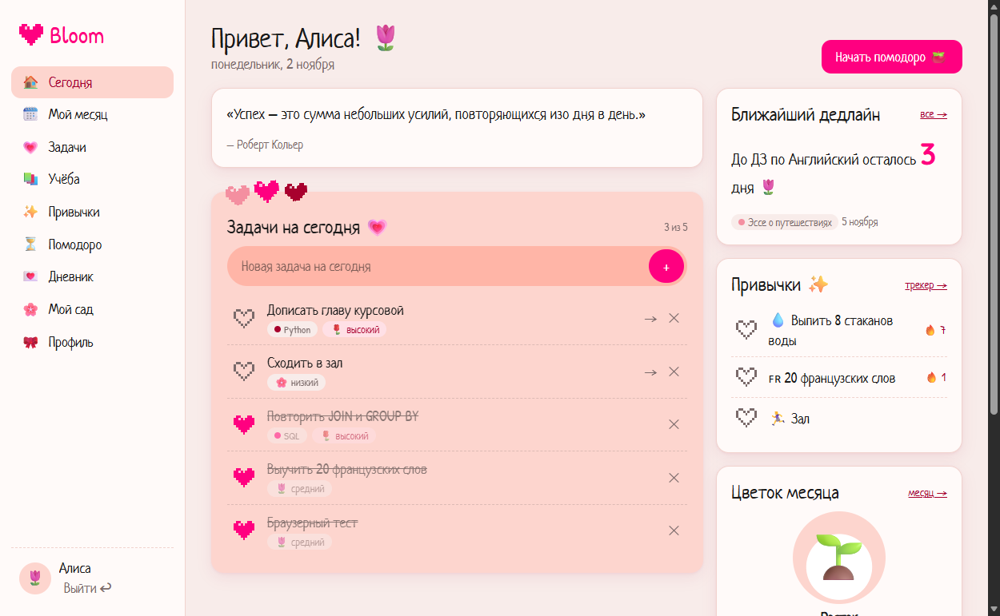
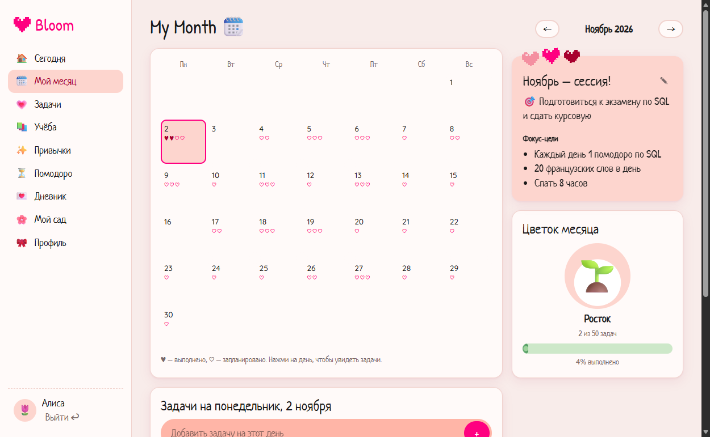
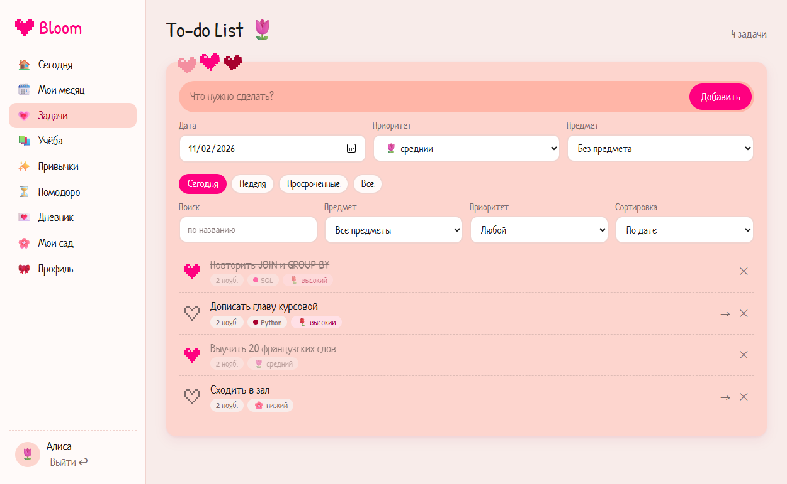
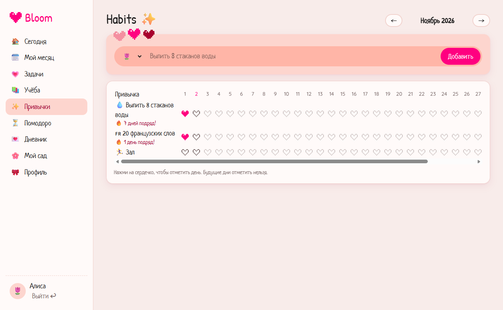
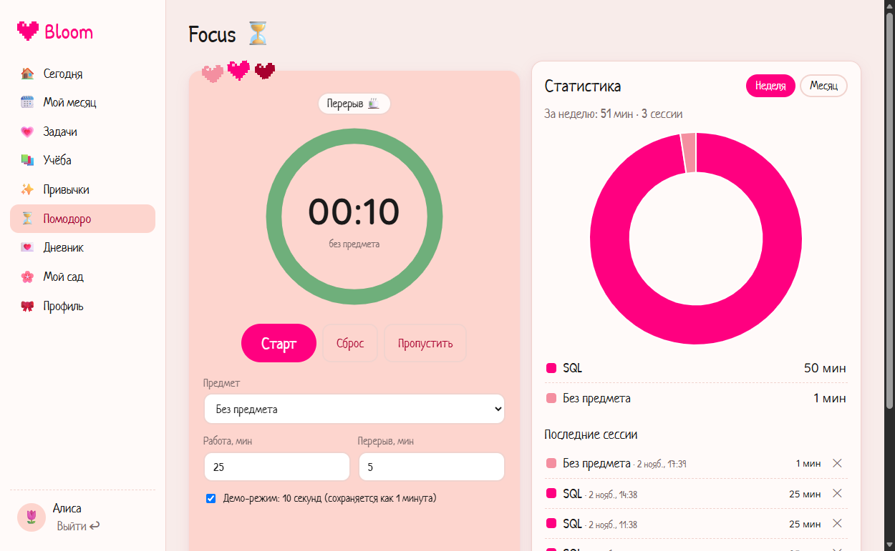
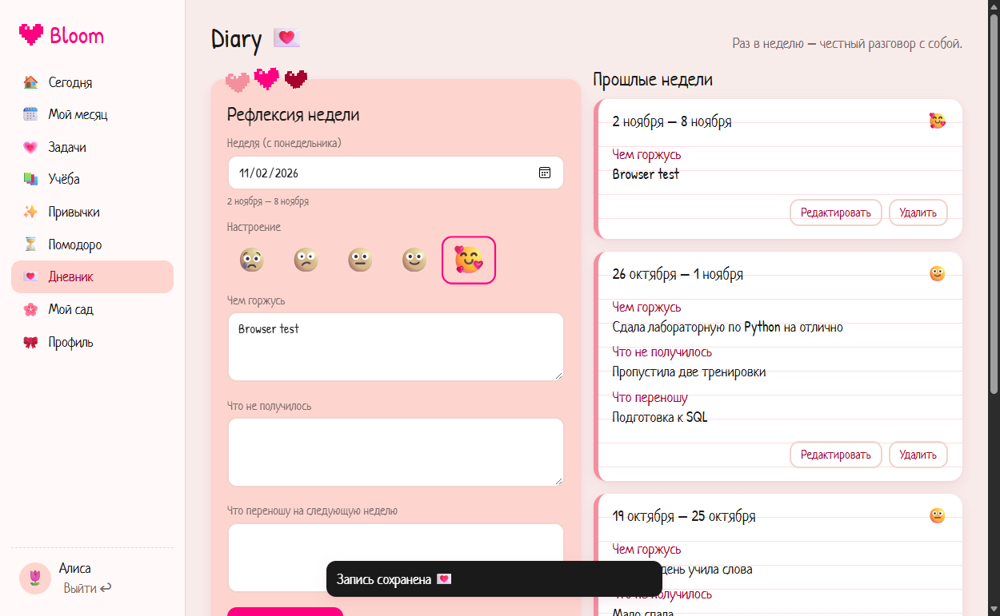
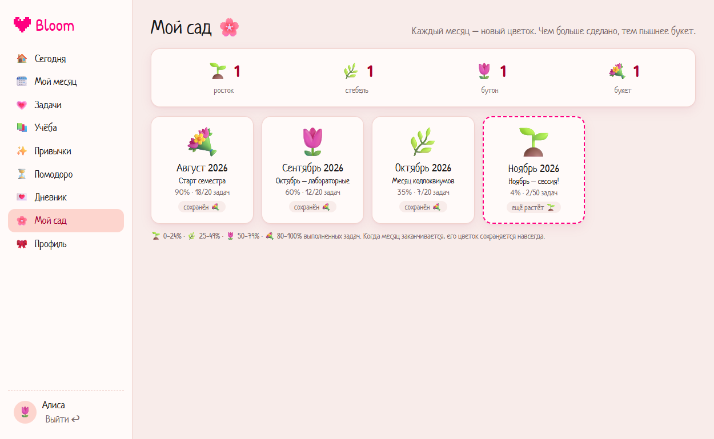

# 🌷 Bloom — a cute study planner

Diploma project for the course *Python Base · SQL Database · Django MVT · Django REST Framework*.
The full specification is in [`TZ Bloom Planner.md`](TZ%20Bloom%20Planner.md).

Bloom is a web planner for students: a monthly plan with a calendar, to-do tasks with pixel-heart
checkboxes, subjects / deadlines / timetable, a habit tracker, a Pomodoro timer with statistics and a
weekly reflection diary. **The main feature is the garden:** every finished task waters the flower of
the month (🌱 → 🌿 → 🌷 → 💐) and finished months are kept as bouquets in "My garden".



| Month | Tasks | Habits |
|---|---|---|
|  |  |  |
| **Focus** | **Diary** | **Garden** |
|  |  |  |

---

## Features

| Module | What it does |
|---|---|
| Accounts | Registration, login, logout (session for the site, JWT for the API); profile with name, avatar, accent colour (pink / lavender / peach) and semester goal |
| Month plan | Title, main goal, up to 3 focus goals; calendar with a heart per task; click a day to see/add its tasks; progress shown as a growing vine |
| Tasks | Title, description, date, priority 🌸/🌷/🌹, optional subject; heart checkbox with a "pulse" animation, ✕ to delete, click to edit, "→" moves to tomorrow; filters today / week / overdue / subject / priority, search, sorting, "show more" pagination; confetti when all tasks of the day are done |
| Study | Subjects (colour, teacher, room), deadlines (exam / test / coursework / homework) with countdown "До экзамена по SQL осталось 12 дней 🌷", Mon–Sat timetable |
| Habits | Month grid of heart checkboxes, streak "🔥 7 дней подряд!", archive and delete |
| Focus | Pomodoro 25/5 (configurable), linked to a subject, sessions saved to the database, doughnut chart of time per subject (week / month), demo mode of 10 seconds |
| Diary | Weekly reflection: mood (5 emoji), "proud of", "didn't work", "carry over"; diary-style feed |
| Garden | Flower stage of every month; finished months are locked as bouquets |
| Today | Greeting + quote of the day, today's tasks, nearest deadline, today's habits, month flower, "Start pomodoro" |
| Admin | Django Admin for users, profiles, all records and the quote list |

## Technologies

- Python 3.13 (3.11+ works), **Django 6.1**, Django REST Framework 3.18
- `djangorestframework-simplejwt` (JWT + refresh-token blacklist), `django-filter`
- `drf-spectacular` + `drf-spectacular-sidecar` (Swagger UI / ReDoc served locally)
- `python-decouple` (`.env`), `Pillow` (avatars), `whitenoise` (static files in production)
- SQLite for development, PostgreSQL for production
- Frontend: Django templates, CSS, vanilla JavaScript (`fetch`), Chart.js 4.4.4 (kept in `static/vendor/`)

## Project structure

```
DRF PROJECT/
├── config/
│   ├── settings/         # base.py (shared), dev.py, prod.py
│   ├── urls.py           # admin, /api/v1/, /api/schema/, /api/docs/, website
│   └── wsgi.py / asgi.py
├── accounts/             # Profile, registration, JWT login/refresh/logout, profile API, post_save signal
├── planner/              # MonthPlan, Task, Quote, garden rules (services.py), filters,
│   ├── management/commands/  close_months.py, seed_demo.py
│   └── fixtures/demo.json
├── study/                # Subject, Deadline, ScheduleSlot
├── habits/               # Habit, HabitCheck, streak (services.py)
├── focus/                # PomodoroSession, statistics
├── diary/                # WeeklyReflection
├── api/                  # router (urls.py), IsOwner permission, dashboard view
├── web/                  # MVT pages, registration form, navigation context processor
├── templates/
│   ├── base.html         # HTML skeleton, fonts, CSS, api.js
│   ├── app.html          # layout after login: sidebar + mobile bottom bar
│   └── web/…             # one template per page
├── static/
│   ├── css/bloom.css     # design system (colours, cards, capsule input, hearts…)
│   ├── js/api.js         # fetch wrapper with CSRF, safe DOM helpers, heart checkbox, toasts
│   ├── js/tasks.js, today.js, month.js, study.js, habits.js, timer.js, diary.js
│   ├── img/hearts/       # pixel heart SVG stickers
│   └── vendor/           # Chart.js 4.4.4 (MIT)
├── docs/screenshots/
├── requirements.txt      # development + common
└── requirements-prod.txt # + gunicorn, psycopg
```

---

## Running on Windows (PowerShell in VS Code)

```powershell
# 1. Go to the project folder
cd "C:\Users\<you>\Desktop\DRF PROJECT"

# 2. Create and activate the virtual environment (once)
py -3.13 -m venv .venv
.\.venv\Scripts\Activate.ps1
#    If PowerShell blocks the script, run once:
#    Set-ExecutionPolicy -Scope CurrentUser RemoteSigned

# 3. Install the dependencies
python -m pip install --upgrade pip
pip install -r requirements.txt

# 4. Environment variables: copy the template and set a SECRET_KEY
copy .env.example .env
python -c "from django.core.management.utils import get_random_secret_key as g; print(g())"
#    paste the printed value after SECRET_KEY= in .env

# 5. Database
python manage.py migrate

# 6. Administrator account (for /admin/)
python manage.py createsuperuser

# 7. Demo data (optional) — user "demo", password "bloom-demo-2026"
python manage.py seed_demo          # dates around today (recommended)
#  or: python manage.py loaddata demo.json   (fixed dates from November 2026)

# 8. Start the server
python manage.py runserver
```

Then open:

| URL | What |
|---|---|
| http://127.0.0.1:8000/ | Landing page → register or log in |
| http://127.0.0.1:8000/today/ | Dashboard (after login) |
| http://127.0.0.1:8000/admin/ | Django Admin |
| http://127.0.0.1:8000/api/docs/ | **Swagger UI** |
| http://127.0.0.1:8000/api/redoc/ | ReDoc |
| http://127.0.0.1:8000/api/schema/ | OpenAPI schema (YAML) |

### Environment variables (`.env`)

| Variable | Used in | Meaning |
|---|---|---|
| `SECRET_KEY` | dev (optional), prod (required) | Django secret key |
| `DEBUG` | dev | `True` / `False` |
| `TIME_ZONE` | both | Default `Europe/Moscow`; "today", streaks and `done_at` depend on it |
| `DJANGO_SETTINGS_MODULE` | prod | `config.settings.prod` |
| `ALLOWED_HOSTS`, `CSRF_TRUSTED_ORIGINS` | prod | Comma-separated host names / `https://` origins |
| `DB_NAME`, `DB_USER`, `DB_PASSWORD`, `DB_HOST`, `DB_PORT` | prod | PostgreSQL connection |
| `SECURE_SSL_REDIRECT`, `SECURE_HSTS_SECONDS` | prod | HTTPS options |

`manage.py` uses `config.settings.dev`; `wsgi.py` / `asgi.py` use `config.settings.prod`.

---

## REST API

Base prefix: **`/api/v1/`**. Everything except registration and token endpoints requires
authentication. Every list is limited to the current user's own records; another user's object
returns **404** (it is filtered out of `get_queryset()`, and `IsOwner` checks objects again).

### Authentication

| Method | URL | Description |
|---|---|---|
| POST | `/auth/register/` | Register (`username`, `email`, `password`, `password2`) |
| POST | `/auth/token/` | Get JWT `access` + `refresh` (alias: `/auth/login/`) |
| POST | `/auth/token/refresh/` | New access token (alias: `/auth/refresh/`); refresh tokens rotate |
| POST | `/auth/logout/` | Blacklist a refresh token (`{"refresh": "…"}`) |
| GET/PATCH | `/profile/` | Own profile, JSON or multipart (avatar) (alias: `/auth/profile/`) |

In Swagger: call `POST /api/v1/auth/token/`, press **Authorize** and paste the `access` value.
When you are logged in on the website, Swagger also works with the session cookie.

### Planner

| Method | URL | Description |
|---|---|---|
| GET/POST | `/months/` | Month plans (filters `year`, `month`); each has `progress` and `is_finished` |
| GET/PATCH/DELETE | `/months/{id}/` | One month (`year`/`month` cannot be changed) |
| GET | `/months/{id}/calendar/` | Tasks per day: `[{date, total, done}]` |
| GET | `/months/{id}/garden/` | `{total, done, percent, stage, emoji, is_final}` |
| GET/POST | `/tasks/` | Filters `date`, `date_from`, `date_to`, `overdue`, `subject`, `priority`, `is_done`, `month_plan`; `search` (title); `ordering` = `date`, `priority`, `created_at`; 20 per page |
| GET/PATCH/PUT/DELETE | `/tasks/{id}/` | One task |
| POST | `/tasks/{id}/toggle/` | Mark done / not done (sets / clears `done_at`) |
| POST | `/tasks/{id}/move-tomorrow/` | Move an unfinished task to the next day |
| GET | `/tasks/today/` | Today's tasks |
| GET | `/quotes/` | Quote list (read-only; edited in the admin) |

### Study, habits, focus, diary, dashboard

| Method | URL | Description |
|---|---|---|
| CRUD | `/subjects/` | Subjects |
| CRUD | `/deadlines/` | Deadlines, sorted by date, with `days_left` |
| GET | `/deadlines/upcoming/` | Next 3 deadlines with days left |
| CRUD | `/schedule/` | Timetable slots (weekday 0–5 = Mon–Sat) |
| CRUD | `/habits/` | Habits (with `checked_today`) |
| POST | `/habits/{id}/check/` | Check a day (`{"date": …}`, default today); calling again removes the check |
| GET | `/habits/{id}/streak/` | Current streak |
| GET | `/habits/grid/?year=&month=` | All habits with checked days of a month (for the tracker grid) |
| GET/POST/DELETE | `/habit-checks/` | Individual checks (filters `habit`, `date_from`, `date_to`) |
| GET/POST | `/pomodoro/` | Pomodoro sessions (`subject`, `duration_min`, optional `started_at`) |
| GET | `/pomodoro/stats/?period=week` | Minutes per subject and per day (`week` or `month`), computed with `Sum` / `TruncDate` |
| CRUD | `/reflections/` | Weekly reflections |
| GET | `/dashboard/` | Everything for the Today page in one request |

---

## Tests and checks

```powershell
python manage.py test                                   # 89 tests
python manage.py check
python manage.py makemigrations --check --dry-run
python manage.py migrate --check
python manage.py spectacular --validate --fail-on-warn --file "$env:TEMP\bloom-openapi.yml"
```

The tests cover the specification's required cases (another user's tasks are invisible, `toggle`
changes `is_done` and `done_at`, flower stage at 24/25/49/50/79/80 %, streak with a skipped day,
no duplicate month) plus registration, JWT refresh/logout blacklisting, IDOR on every resource,
serializer validation (foreign month/subject/habit, dates, times, durations), duplicate habit
checks and reflections, dashboard numbers, Pomodoro statistics, demo data and the website login.

---

## Decisions where the specification was open

| Topic | Decision |
|---|---|
| Django version | The project was started with Django 6.1 (spec says 5.x); it was kept to avoid a downgrade of a working environment. |
| Website authentication | The website uses Django's **session cookie + CSRF token** (as in the spec: "sessions for the site, token for the API"). JavaScript never sees or stores a JWT, so an XSS bug cannot steal long-lived tokens from `localStorage`. JWT is used by Swagger and other API clients. |
| `month_plan` of a task | Optional in the API: if omitted, the plan of the task's month is used (created automatically). A task date must lie inside its plan's month; changing the date moves the task to that month's plan. |
| Move to tomorrow | New date = max(task date, today) + 1 day, so overdue tasks go to tomorrow. Finished tasks are not moved. |
| Flower stage | `percent = done / total × 100`; < 25 seedling, < 50 stem, < 80 bud, otherwise bouquet; no tasks = 0 %. |
| End of month | `final_stage` is saved the first time the month list is requested after the month ended (and by `python manage.py close_months`, which can be scheduled). After that the bouquet no longer changes. |
| Streak | Days in a row ending today; if today is not checked yet, the streak ending yesterday still counts. |
| Week | Calendar week Monday–Sunday (Pomodoro statistics, reflections). A reflection's `week_start` must be a Monday. |
| Pomodoro demo mode | 10-second timer for the presentation; saved as a 1-minute session (the model stores whole minutes). Durations 1–180 min. |
| Priority sorting | Priorities are stored as `low/mid/high`; sorting uses a numeric rank (Case/When) so it is not alphabetical. |
| Quote of the day | Same quote all day: `quotes[day_number % count]`; a built-in quote is shown if the list is empty. |
| Admin reference data | Only `Quote` is a reference model (the spec's model list has no icon/flower models). |
| Language and fonts | Interface in Russian; headings use the spec's English titles ("To-do List 🌷", "My Month 🗓️", "Habits ✨"). Patrick Hand has no Cyrillic, so Neucha (Cyrillic handwriting) is the fallback; Quicksand for numbers. |
| Mobile menu | 5 icons: Today, Month, Tasks, Focus and "Ещё" (Study, Habits, Diary, Garden, Profile, Logout). |
| Extra endpoints | `/habits/grid/`, `/habit-checks/`, `/quotes/`, `/auth/token/refresh/`, `/auth/logout/` — needed by the frontend or by JWT. |
| Pagination | Default page size 20 for all lists (the frontend follows `next` links where it needs everything). |

## Deployment notes (not deployed yet)

The code is prepared for a Linux host such as **Render** (web service + PostgreSQL):

1. Create a PostgreSQL database and a web service from this repository.
2. Build command: `pip install -r requirements-prod.txt && python manage.py collectstatic --noinput && python manage.py migrate`
3. Start command: `gunicorn config.wsgi`
4. Environment variables: `DJANGO_SETTINGS_MODULE=config.settings.prod`, `SECRET_KEY`, `ALLOWED_HOSTS`,
   `CSRF_TRUSTED_ORIGINS`, `DB_NAME`, `DB_USER`, `DB_PASSWORD`, `DB_HOST`, `DB_PORT`, `TIME_ZONE`.
5. Create the admin with `python manage.py createsuperuser` in the service shell; optionally `python manage.py seed_demo`.
6. Optionally schedule `python manage.py close_months` daily.

Known limitation: uploaded avatars are stored on the server's disk (`media/`). Render's free disk is
wiped on every deploy and production does not serve `/media/` by itself, so for real use add a
persistent disk or object storage (e.g. S3 via `django-storages`). PythonAnywhere's free plan has
no PostgreSQL; there use MySQL or SQLite instead.
